  

# 🚀 Awesome Cloud Software Testing SaaS Platform 

  
  
  
  
  
  

---

## 🌟 Top Cloud Software Testing & QA Engineering SaaS Platform Ecosystem

> **Curated List of SaaS Products & Open-Source GitHub Projects**  
> *Focused on Cross-Browser Testing, Test Automation, Real Device Clouds & AI-Assisted Quality Engineering*  
> **Last updated: March 2026**

This repository is an authoritative, SEO-optimized directory tracking notable **cloud software testing platforms**, **cross-browser testing SaaS**, **real-device testing labs**, and **open-source test automation projects**. These solutions power distributed test execution grids, CI/CD pipeline quality gates, visual regression testing, API automation, and AI-driven autonomous test healing for high-scale engineering teams.

Key commercial leaders tracked include **BrowserStack**, **Sauce Labs**, **LambdaTest (TestMu AI)**, **SmartBear**, **Tricentis**, **Applitools**, **mabl**, **Testim**, **Katalon**, and **HeadSpin**.

For engineering teams seeking vendor-neutral infrastructure and self-hosted Kubernetes test grids without per-parallel cloud subscription surcharges, this list details top-tier open-source testing frameworks like **Playwright**, **Puppeteer**, **Cypress**, **Selenium**, **Appium**, and **k6**.

---

## 📑 Table of Contents
- [📊 Sector Overview & Market Dynamics](#-sector-overview--market-dynamics)
- [☁️ SaaS / Hosted Cloud Testing Platforms](#️-saas--hosted-cloud-testing-platforms)
- [💻 Open-Source GitHub Projects](#-open-source-github-projects)
- [🛠️ How to Contribute](#️-how-to-contribute)
- [📈 Star History](#-star-history)
- [💖 Support & Sponsorship](#-support--sponsorship)
- [📜 Disclaimer](#-disclaimer)

---

## 📊 Sector Overview & Market Dynamics

The **cloud software testing and automated testing market** is valued at **$20B–$24B+** in 2025–2026 (with pure cloud-testing infrastructure accounting for over $2B and the wider software testing industry exceeding $50B). Propelled by rapid CI/CD velocity, multi-platform mobile proliferation, and generative AI test authoring, the sector expands at a compounding annual growth rate (CAGR) of **13%–17%**.

The sector exhibits **moderate fragmentation** rather than winner-take-all dynamics:
- **Enterprise Consolidators & Grids:** Scale leaders like **Tricentis**, **SmartBear**, **BrowserStack**, and **Sauce Labs** dominate Fortune 500 quality programs with deep enterprise compliance, multi-device grids, and legacy integrations.
- **Specialized Innovators:** Disruptors hold dominant niches across visual regression testing (Applitools), AI self-healing automation (mabl, Testim), and localized real-carrier testing (HeadSpin).
- **Ubiquitous Open Source:** Community frameworks like **Playwright**, **Cypress**, and **Selenium** serve as the bedrock test authoring layer, preventing single-vendor lock-in and empowering teams to build elastic, hybrid test grids.

---

## ☁️ SaaS / Hosted Cloud Testing Platforms

| Product | Company Scale (Valuation / Revenue) | Description | Starting Pricing | Free Tier / Trial Limits |
|---|---|---|---|---|
| **[Tricentis](https://www.tricentis.com/)** | **~$4.5B valuation** (~$500M ARR) | Enterprise continuous testing & test automation platform suite (Tosca, qTest, NeoLoad). | Starting at ~$20,000/year (enterprise contract licensing) | 14-day free trial for Tosca with guided walkthroughs and full functional access; custom POCs for enterprise suites. |
| **[BrowserStack](https://www.browserstack.com/)** | **$4.0B valuation** (~$230M ARR) | Cloud testing platform with 3,000+ browsers and 30,000+ real mobile devices covering Live, Automate, and Percy. | Live: from $12.50/user/month (annual); Automate: from $59/month per parallel; Percy: $199/month | **Free (Percy Visual)**: permanent 5,000 screenshots/month. Live/Automate free trial provides 30–100 automated & manual test minutes and up to 100 screenshots. |
| **[SmartBear](https://smartbear.com/)** | **~$1.8B–$1.9B valuation** (~$150M+ revenue) | Comprehensive testing & quality engineering portfolio including TestComplete, ReadyAPI, BitBar, and Zephyr. | BitBar: from $39/month (annual); Zephyr Essential: from $10/user/month; TestComplete: from $1,210/year | 14-day free trial on BitBar with full live/automated device cloud access; 14-to-30 day free trial on TestComplete and ReadyAPI. |
| **[Sauce Labs](https://saucelabs.com/)** | **~$500M–$613M valuation** (~$92M revenue) | Cloud testing grid supporting Selenium, Playwright, Appium, Cypress across desktop and real mobile device clouds. | Live Testing: from $39/month (annual, 1 parallel); Virtual Device Cloud: from $149/month; Real Devices: from $199/month | 28-day free trial with 3 concurrent virtual machines, access to real devices & emulators, 60–100 testing minutes, and 50 AI queries. |
| **[Testim](https://www.testim.io/)** *(Tricentis)* | **~$450M–$500M** *(included in Tricentis)* | AI-native low-code test automation platform featuring self-healing tests, smart locators, and parallel cloud execution. | Starting at ~$450/month (billed annually; ~$12,000–$15,000/year enterprise base) | **Free Community Plan**: up to 1,000 free web test runs per month. Paid features include a 7-day to 14-day free trial. |
| **[LambdaTest (TestMu AI)](https://www.lambdatest.com/)** | **~$400M valuation** (~$21M–$50M+ revenue) | Cloud grid offering 10,000+ browser/OS combinations, HyperExecute test orchestration, SmartUI, and KaneAI test agent. | Live: from $15/month (annual); Automation Desktop: from $79/month per parallel; KaneAI: from $199/agent/month | **Free Plan**: permanent free tier with 2-minute live sessions, 200+ desktop browsers, 2 emulator app sessions/month, and 100 lifetime automation minutes on 2 parallel sessions. |
| **[mabl](https://www.mabl.com/)** | **~$360M–$400M valuation** (~$25M–$35M ARR) | AI-native low-code test automation across web, mobile, API, and accessibility with automated self-healing. | Starting at ~$499/month (Starter tier, billed annually) | 14-day free trial with 500 test run credits, up to 10 concurrent browser test runs, and 25 API test runs. |
| **[Applitools](https://applitools.com/)** | **$250M acquisition** (~$25M–$30M ARR) | Visual AI testing platform with Ultrafast Grid, cross-environment visual validation, and root-cause analysis. | Starter Plan: $667/month (billed annually at $8,004/year for 1,000 page checkpoints/month) | **Free Tier**: 100 visual checkpoints/month forever. 14-day free trial on premium tiers; 10,000 checkpoints/month for verified open-source projects. |
| **[Katalon](https://katalon.com/)** | **~$100M–$250M est. valuation** (~$36M–$60M ARR) | Integrated low-code/full-code quality platform across web, mobile, desktop, and API testing with TestOps. | Katalon Platform: from $135–$150/user/seat/month (annual); Studio Enterprise: from $229/seat/month | **Free Plan**: permanent desktop Katalon Studio authoring and up to 2,000 test results/month in TestOps. 30-day free trial for Enterprise features. |
| **[HeadSpin](https://www.headspin.io/)** | **~$28.2M acquisition** (~$21M revenue) | Real-device global digital experience and testing platform with SIM-enabled mobile and OTT devices and performance KPIs. | CloudTest Go: from $83/device/month (annual) or $100/device/month; CloudTest Lite available | 14-day free trial / guided Proof of Concept (PoC) on real device public cloud upon registration/demo request. |

---

## 💻 Open-Source GitHub Projects

The following table catalogues top-tier open-source tools and infrastructure for building self-hosted, scalable testing clouds and automation pipelines, sorted in descending order by GitHub stargazers count:

| Project | GitHub_Stars | Description | Category / Stack |
|---|---|---|---|
| **[Playwright](https://github.com/microsoft/playwright)** |  | Fast, reliable cross-browser automation framework by Microsoft supporting Chromium, Firefox, and WebKit with a single unified API. Includes automatic waiting, network mocking, trace viewers, and parallel test sharding. | End-to-End Automation |
| **[Puppeteer](https://github.com/puppeteer/puppeteer)** |  | Node.js library providing a high-level API over the Chrome DevTools Protocol (CDP) and WebDriver BiDi for Chromium and Firefox headless automation, PDF generation, and performance audits. | Headless Browser Automation |
| **[Cypress](https://github.com/cypress-io/cypress)** |  | Developer-friendly frontend testing tool built directly for the modern web with time-travel debugging, real-time reloading, automated wait-free assertions, and network stubbing. | Web E2E Testing |
| **[Selenium](https://github.com/SeleniumHQ/selenium)** |  | Industry-standard browser automation framework and W3C specification reference implementation. Powers distributed multi-browser test execution across diverse languages. | W3C Browser Automation |
| **[k6](https://github.com/grafana/k6)** |  | Modern, developer-centric load and performance testing tool built with Go and JavaScript. Optimized for high-throughput cloud stress testing and CI/CD reliability checks. | Load & Performance Testing |
| **[Locust](https://github.com/locustio/locust)** |  | Scalable, distributed user load testing framework defined in clean, idiomatic Python code. Features real-time web UI performance metrics and event hooks. | Distributed Load Testing |
| **[Appium](https://github.com/appium/appium)** |  | Cross-platform mobile test automation engine supporting native, hybrid, and mobile-web applications on iOS, Android, and desktop platforms via WebDriver protocols. | Mobile & Device Automation |
| **[KEDA](https://github.com/kedacore/keda)** |  | Kubernetes Event-driven Autoscaling component that dynamically scales containerized browser execution nodes down to zero or up based on test queue depth and metrics. | Kubernetes Grid Autoscaling |
| **[WebdriverIO](https://github.com/webdriverio/webdriverio)** |  | Extensible, pluggable next-generation test automation framework for Node.js supporting both WebDriver and Chrome DevTools Protocol / Puppeteer natively. | Web & Mobile Framework |
| **[docker-selenium](https://github.com/SeleniumHQ/docker-selenium)** |  | Official Docker images for Selenium Grid 4 with Chrome, Firefox, and Edge nodes, providing instant containerized browser grid orchestration for Kubernetes and Docker Swarm. | Docker Grid Infrastructure |
| **[Allure Report](https://github.com/allure-framework/allure2)** |  | Flexible, multi-language test execution reporting framework that creates rich visual dashboards, timeline analyses, defect classifications, and failure artifacts. | Test Analytics & Reporting |
| **[Selenoid](https://github.com/aerokube/selenoid)** |  | Lightning-fast, lightweight Golang implementation of Selenium Hub that boots isolated ephemeral browsers inside Docker containers per test session. | Containerized Grid Engine |
| **[ReportPortal](https://github.com/reportportal/reportportal)** |  | AI-powered centralized test automation dashboard and analytics engine for aggregate test results, auto-categorization of failures, and historical trend monitoring. | AI Test Analytics Dashboard |
| **[Moon by Aerokube](https://github.com/aerokube/moon)** |  | Kubernetes-native cloud browser automation platform supporting Selenium, Playwright, Puppeteer, and Cypress with dynamic pod lifecycle management. | Kubernetes Browser Cloud |
| **[WebSummoner](https://github.com/WebSummoner/websummoner)** |  | Active community-maintained Selenoid successor written in Go, launching ephemeral browser instances per session with Selenoid API compatibility. | Ephemeral Container Grid |

---

### 💡 Building a Custom In-House Testing Cloud
Modern engineering platforms frequently construct cost-effective, self-hosted testing grids by combining:
1. **Authoring & Execution:** [Playwright](https://github.com/microsoft/playwright) or [Cypress](https://github.com/cypress-io/cypress) for rock-solid test resilience.
2. **Containerized Grid:** [docker-selenium](https://github.com/SeleniumHQ/docker-selenium) or [Selenoid](https://github.com/aerokube/selenoid) for instant browser provisioning.
3. **Dynamic Scaling:** [KEDA](https://github.com/kedacore/keda) to scale Kubernetes browser runner pods on-demand (scaling to zero when idle).
4. **Unified Reporting:** [Allure Report](https://github.com/allure-framework/allure2) or [ReportPortal](https://github.com/reportportal/reportportal) for defect triage.

---

## 🛠️ How to Contribute

Contributions are warmly welcomed! Help make this the most comprehensive and accurate directory for cloud testing tools:

1. 🍴 **Fork the repository** on GitHub.
2. 🌿 **Create a new branch** (`git checkout -b feature/add-new-platform`).
3. 📝 **Add or edit entries** following the established markdown schema (include factual starting pricing, explicit free tier limits, company valuation/revenue, and GitHub Stars_Badges).
4. ✅ **Ensure accuracy** and verify links point to official websites or GitHub repositories.
5. 🚀 **Submit a Pull Request** with a concise description of your additions.

---

## 📈 Star History

---

## 💖 Support & Sponsorship

If you find this curated collection useful for your QA architecture, team benchmarking, or cloud testing research:

- ⭐ **Star this repository** to show your appreciation and help others discover it!
- 🍴 **Fork and share** it with your engineering and DevOps colleagues.
- ☕ **Buy me a coffee & support future updates**: Support ongoing curation directly via the [GitHub Sponsor Dashboard](https://github.com/sponsors/ishandutta2007).

Your backing ensures this repository remains up-to-date, transparent, and completely free for the developer community!

---

## 📜 Disclaimer

- This is an independent, community-curated ecosystem map. It is neither sponsored nor an endorsement of any listed vendor or platform.
- Cloud testing environments handle authentication secrets, API keys, and test data; always adhere to least-privilege principles and isolate test environments.
- Listed enterprise contract pricing and SaaS tiers represent publicly observable rates and baseline estimates; enterprise agreements are subject to vendor negotiation.

---

  <b>Built with ❤️ for QA Engineers, Test Automation Architects, SDETs & Platform Teams worldwide.</b>

